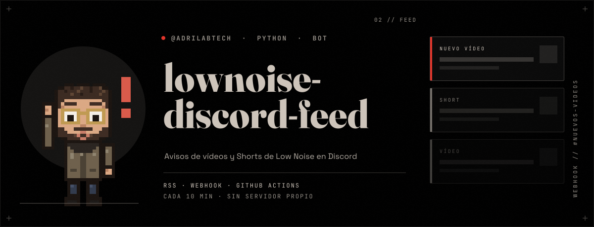

# lownoise-discord-feed

Publica en el Discord de Low Noise cada vídeo y Short nuevo del canal de YouTube, sin servidor propio.

- `feed.py`: lee el RSS del canal y envía un embed por **webhook** de Discord (solo stdlib de Python).
- `.github/workflows/feed.yml`: se ejecuta cada 10 min en GitHub Actions; guarda lo ya publicado en `state.json`.
- Secreto necesario: `DISCORD_WEBHOOK` (Settings → Secrets → Actions). El webhook solo puede escribir en `#nuevos-videos`.
- Probar sin enviar: `YOUTUBE_CHANNEL_ID=UC… python3 feed.py --dry-run`
- GitHub no garantiza la puntualidad del cron: puede retrasarse unos minutos.
